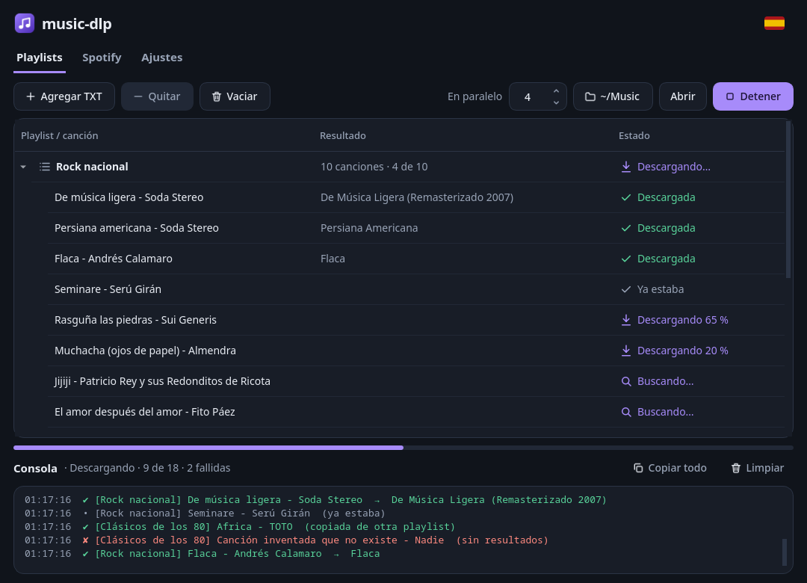
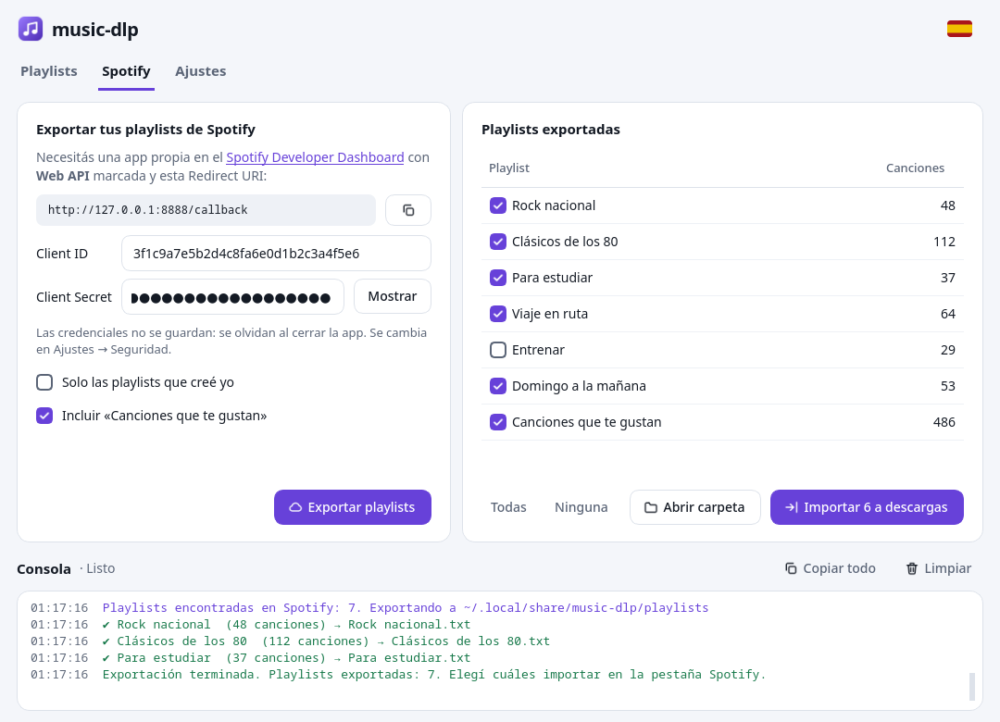
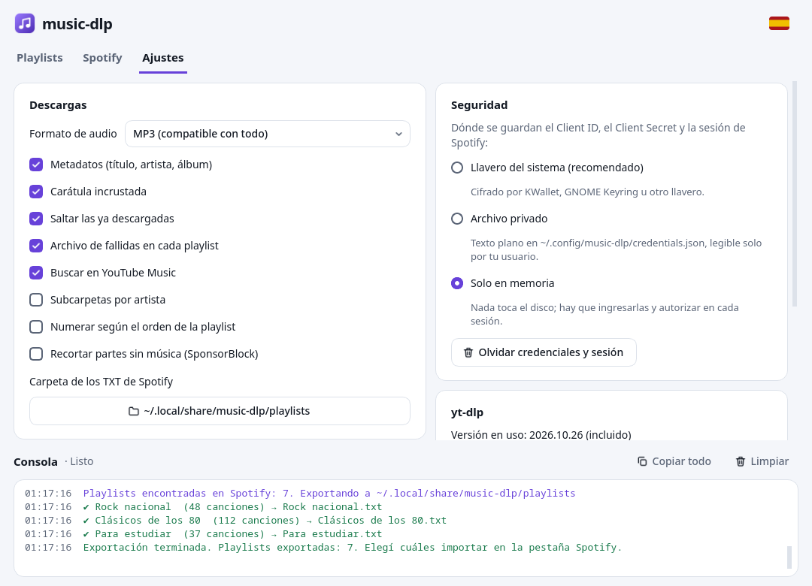

# music-dlp

[English](README.md) | **Español**


Una app de escritorio que descarga playlists como archivos de audio con sus metadatos. Cada lista `.txt` es una playlist: la arrastrás, apretás **Descargar** y cada canción queda en una carpeta con el nombre de la lista. También exporta tus playlists de Spotify a `.txt` y las importa con un clic.

Usa [yt-dlp](https://github.com/yt-dlp/yt-dlp) y ffmpeg, los dos incluidos en el AppImage.



| Spotify | Ajustes |
|---|---|
|  |  |

## Qué hace

- Arrastrar y soltar listas `.txt` (o carpetas con listas); una playlist por archivo.
- De 1 a 16 descargas en paralelo.
- MP3, Opus, M4A o FLAC, con título, artista, álbum y carátula incrustados.
- Busca cada canción primero en YouTube Music y después en YouTube. Las líneas también pueden ser URLs (un video o una playlist entera).
- Saltea lo que ya está descargado. Si una canción ya la tenés en otra playlist, la copia en vez de bajarla de nuevo.
- Las canciones que fallan quedan en `fallidas.txt` dentro de la carpeta de la playlist, listas para volver a arrastrar.
- Exportación de Spotify incluida: un `.txt` por playlist, y después elegís cuáles importar.
- Una consola abajo muestra qué pasa con cada canción.
- Español e inglés, tema claro y oscuro (sigue al sistema).
- Sin telemetría. Solo se conecta a YouTube, a Spotify cuando exportás y a PyPI cuando actualizás yt-dlp.

## Instalación

Bajá `music-dlp-<versión>-x86_64.AppImage` y `SHA256SUMS` de las [releases](https://github.com/mrsalvaa/music-dlp/releases) y después:

```bash
sha256sum -c SHA256SUMS
chmod +x music-dlp-*-x86_64.AppImage
./music-dlp-*-x86_64.AppImage
```

No hace falta nada más. Si tenés [deno](https://deno.com) instalado, yt-dlp lo usa y YouTube ofrece más formatos; la app funciona sin él.

## Las listas

Una canción por línea. Cada línea es un nombre o una URL; las líneas vacías y las que empiezan con `#` se ignoran.

```
Bohemian Rhapsody - Queen
Under Pressure - Queen, David Bowie
https://www.youtube.com/watch?v=dQw4w9WgXcQ
```

Una lista llamada `Viaje.txt` se guarda así:

```
~/Música/
└── Viaje/
    ├── Queen - Bohemian Rhapsody.mp3
    ├── Queen - Under Pressure.mp3
    └── Rick Astley - Never Gonna Give You Up.mp3
```

Todas las canciones van sueltas dentro de la carpeta de la playlist. Las **subcarpetas por artista** y la **numeración según el orden de la playlist** son opcionales, en Ajustes.

Al buscar por nombre se baja el primer resultado. YouTube casi siempre devuelve algo, así que un nombre mal escrito baja la canción equivocada en vez de fallar: la columna **Resultado** muestra el título que realmente se bajó.

## Exportar de Spotify

Necesitás una app propia en el [Spotify Developer Dashboard](https://developer.spotify.com/dashboard):

1. Creá una app (el nombre y la descripción pueden ser cualquiera).
2. En **Settings → Edit**, agregá la Redirect URI `http://127.0.0.1:8888/callback` y marcá **Web API**.
3. Copiá el **Client ID** y el **Client Secret** en la pestaña Spotify y apretá **Exportar playlists**.

La primera vez se abre el navegador para que autorices la app. Las playlists exportadas aparecen a la derecha: marcá las que quieras y apretá **Importar a descargas**.

Mientras tu app de Spotify esté en modo desarrollo, solo la pueden usar las cuentas que agregues en **User Management**. Además, Spotify no deja que las apps en modo desarrollo lean algunas playlists, sobre todo las que genera él (Descubrimiento semanal, Daily Mix…); esas se informan en la consola y se saltean.

## Seguridad

En **Ajustes → Seguridad** elegís dónde se guardan el Client ID, el Client Secret y la sesión de Spotify:

| Modo | Qué hace |
|---|---|
| Llavero del sistema (por defecto) | Cifrado por KWallet, GNOME Keyring o cualquier llavero Secret Service. Si no hay ninguno disponible, la app usa la memoria durante esa sesión. |
| Archivo privado | Texto plano en `~/.config/music-dlp/credentials.json`, permisos 600. |
| Solo en memoria | Nada se escribe en disco; ingresás las credenciales y autorizás en cada sesión. |

Al cambiar de modo las credenciales se mueven y se borran del almacén anterior. **Olvidar credenciales y sesión** las borra de todos lados.

## Actualizar yt-dlp

YouTube cambia seguido. Si las descargas empiezan a fallar, apretá **Ajustes → Actualizar yt-dlp**. La app baja la última rueda (wheel) de yt-dlp desde PyPI por HTTPS, comprueba su SHA-256 contra el que publica PyPI y la descomprime en `~/.local/share/music-dlp/yt-dlp`. Si borrás esa carpeta, vuelve a la versión incluida.

## Archivos que escribe

| Ruta | Contenido |
|---|---|
| `~/.config/music-dlp/config.json` | Ajustes |
| `~/.config/music-dlp/credentials.json` | Credenciales de Spotify, solo en modo «Archivo privado» |
| `~/.local/share/music-dlp/playlists/` | Los `.txt` exportados de Spotify (la carpeta se puede cambiar) |
| `~/.local/share/music-dlp/yt-dlp/` | El yt-dlp actualizado, si lo actualizaste |
| `<carpeta de la playlist>/.music-dlp.json` | Qué canciones de esa carpeta ya están descargadas |

## Ejecutar desde el código

Requiere Python 3.12 o más nuevo, [uv](https://docs.astral.sh/uv/) y ffmpeg.

```bash
git clone https://github.com/mrsalvaa/music-dlp.git
cd music-dlp
uv venv --python 3.13 .venv
uv pip install --python .venv/bin/python "yt-dlp[default]" PySide6-Essentials keyring secretstorage pytest
PYTHONPATH=src .venv/bin/python -m music_dlp
.venv/bin/python -m pytest -q
```

Para construir el AppImage, dejá [appimagetool](https://github.com/AppImage/appimagetool/releases) en el `PATH` o en `build/appimagetool-x86_64.AppImage` y ejecutá `./packaging/build-appimage.sh`. El resultado y su `SHA256SUMS` quedan en `dist/`.

## Notas

Descargá solo música que tengas derecho a descargar. Este proyecto no está afiliado a Spotify, YouTube ni yt-dlp.

## Licencia

[GPL-3.0-or-later](LICENSE). El AppImage incluye yt-dlp (Unlicense), Qt for Python (LGPL-3.0) y una compilación de FFmpeg (GPL-3.0).
