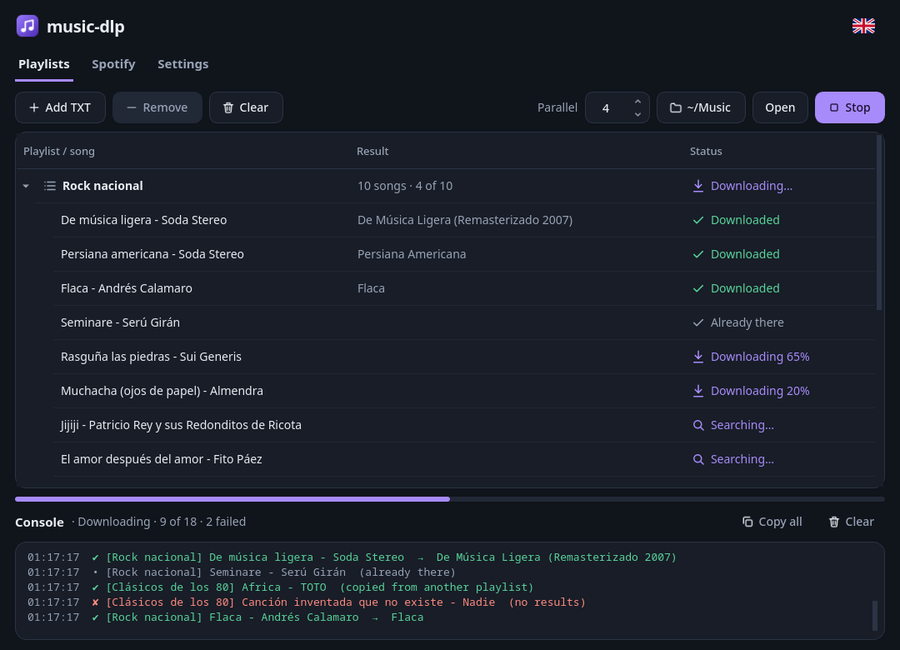
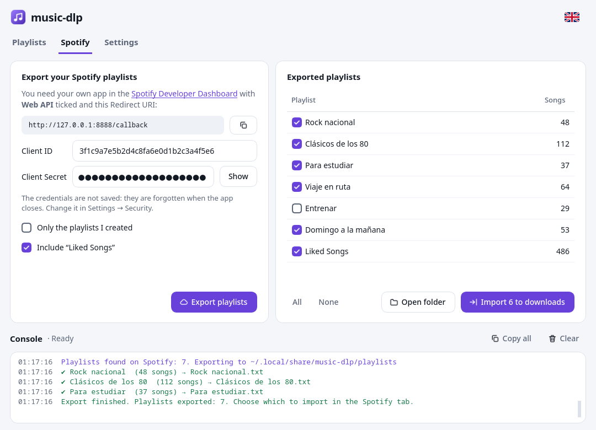
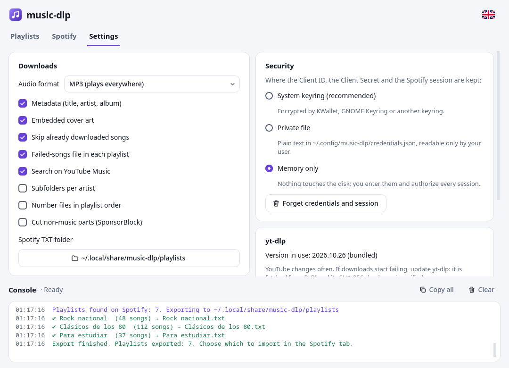

# music-dlp

**English** | [Español](README.es.md)


A desktop app that downloads playlists as tagged audio files. Each `.txt` list is a playlist: drop it in, press **Download**, and every song ends up in a folder named after the list. It also exports your Spotify playlists to `.txt` and imports them in one click.

It uses [yt-dlp](https://github.com/yt-dlp/yt-dlp) and ffmpeg, both included in the AppImage.



| Spotify | Settings |
|---|---|
|  |  |

## Features

- Drag and drop `.txt` lists (or folders of them); one playlist per file.
- 1 to 16 parallel downloads.
- MP3, Opus, M4A or FLAC, with title, artist, album and cover art embedded.
- Songs are searched on YouTube Music first, then on YouTube. Lines can also be URLs (a video or a whole playlist).
- Skips what is already downloaded. A song you already have in another playlist is copied instead of downloaded again.
- Songs that fail are written to `failed.txt` inside the playlist folder, ready to be dropped again.
- Spotify export built in: one `.txt` per playlist, then pick which ones to import.
- A console at the bottom shows what is happening with every song.
- English and Spanish, light and dark theme (follows the system).
- No telemetry. It only connects to YouTube, to Spotify when you export, and to PyPI when you update yt-dlp.

## Install

Download `music-dlp-<version>-x86_64.AppImage` and `SHA256SUMS` from the [releases](https://github.com/mrsalvaa/music-dlp/releases), then:

```bash
sha256sum -c SHA256SUMS
chmod +x music-dlp-*-x86_64.AppImage
./music-dlp-*-x86_64.AppImage
```

Nothing else is needed. If [deno](https://deno.com) is installed, yt-dlp uses it and YouTube offers more formats; the app works without it.

## The lists

One song per line. A line is either a name or a URL; blank lines and lines starting with `#` are ignored.

```
Bohemian Rhapsody - Queen
Under Pressure - Queen, David Bowie
https://www.youtube.com/watch?v=dQw4w9WgXcQ
```

A list called `Road trip.txt` is saved like this:

```
~/Music/
└── Road trip/
    ├── Queen - Bohemian Rhapsody.mp3
    ├── Queen - Under Pressure.mp3
    └── Rick Astley - Never Gonna Give You Up.mp3
```

Every song goes straight into the playlist folder. **Subfolders per artist** and **numbering in playlist order** are optional, in Settings.

When searching by name, the first result is downloaded. YouTube almost always returns something, so a misspelt name downloads the wrong song instead of failing: the **Result** column shows the title that was actually downloaded.

## Spotify export

You need your own app in the [Spotify Developer Dashboard](https://developer.spotify.com/dashboard):

1. Create an app (any name and description).
2. In **Settings → Edit**, add the Redirect URI `http://127.0.0.1:8888/callback` and tick **Web API**.
3. Copy the **Client ID** and the **Client Secret** into the Spotify tab and press **Export playlists**.

The first time, the browser opens so you can authorize the app. The exported playlists then appear on the right: tick the ones you want and press **Import to downloads**.

While your Spotify app is in development mode, only the accounts listed in its **User Management** can use it. Spotify also refuses to let development apps read some playlists, mostly the ones it generates itself (Discover Weekly, Daily Mix…); those are reported in the console and skipped.

## Security

In **Settings → Security** you choose where the Client ID, the Client Secret and the Spotify session are kept:

| Mode | What it does |
|---|---|
| System keyring (default) | Encrypted by KWallet, GNOME Keyring or any Secret Service keyring. If none is available, the app falls back to memory for that session. |
| Private file | Plain text in `~/.config/music-dlp/credentials.json`, mode 600. |
| Memory only | Nothing is written to disk; you enter the credentials and authorize every session. |

Changing the mode moves the credentials and deletes them from the previous store. **Forget credentials and session** deletes them everywhere.

## Updating yt-dlp

YouTube changes often. If downloads start failing, press **Settings → Update yt-dlp**. The app fetches the latest yt-dlp wheel from PyPI over HTTPS, checks its SHA-256 against the one PyPI publishes and unpacks it into `~/.local/share/music-dlp/yt-dlp`. Deleting that folder goes back to the bundled version.

## Files it writes

| Path | Content |
|---|---|
| `~/.config/music-dlp/config.json` | Settings |
| `~/.config/music-dlp/credentials.json` | Spotify credentials, only in "Private file" mode |
| `~/.local/share/music-dlp/playlists/` | The `.txt` files exported from Spotify (folder can be changed) |
| `~/.local/share/music-dlp/yt-dlp/` | The updated yt-dlp, if you updated it |
| `<playlist folder>/.music-dlp.json` | Which songs of that folder are already downloaded |

## Run from source

Requires Python 3.12+, [uv](https://docs.astral.sh/uv/) and ffmpeg.

```bash
git clone https://github.com/mrsalvaa/music-dlp.git
cd music-dlp
uv venv --python 3.13 .venv
uv pip install --python .venv/bin/python "yt-dlp[default]" PySide6-Essentials keyring secretstorage pytest
PYTHONPATH=src .venv/bin/python -m music_dlp
.venv/bin/python -m pytest -q
```

To build the AppImage, put [appimagetool](https://github.com/AppImage/appimagetool/releases) in the `PATH` or in `build/appimagetool-x86_64.AppImage` and run `./packaging/build-appimage.sh`. The result and its `SHA256SUMS` are left in `dist/`.

## Notes

Download only music you have the right to download. This project is not affiliated with Spotify, YouTube or yt-dlp.

## License

[GPL-3.0-or-later](LICENSE). The AppImage includes yt-dlp (Unlicense), Qt for Python (LGPL-3.0) and an FFmpeg build (GPL-3.0).
